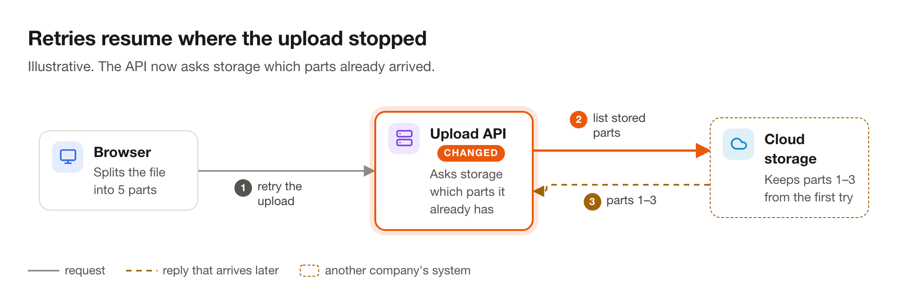
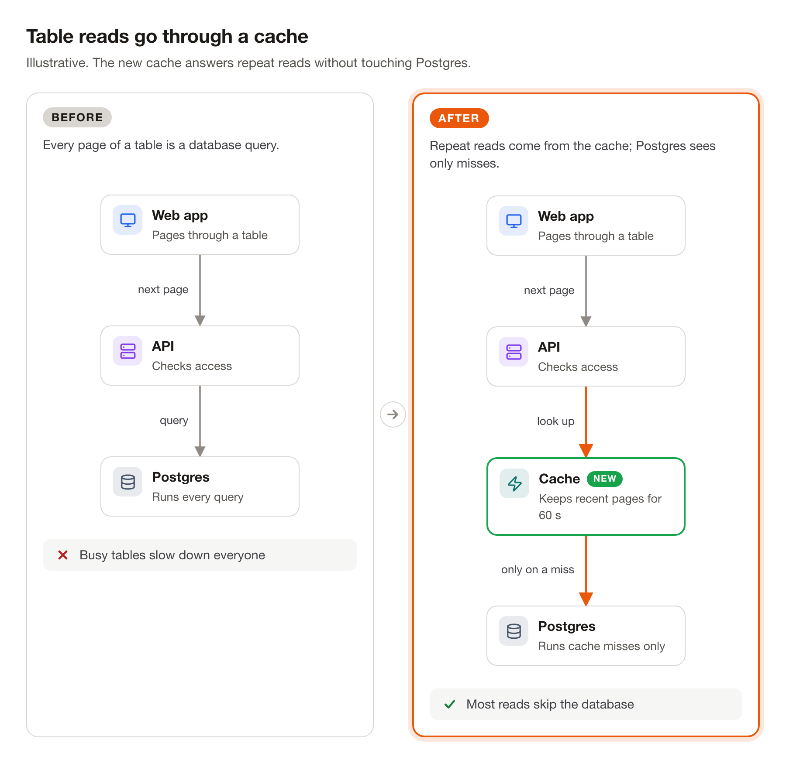
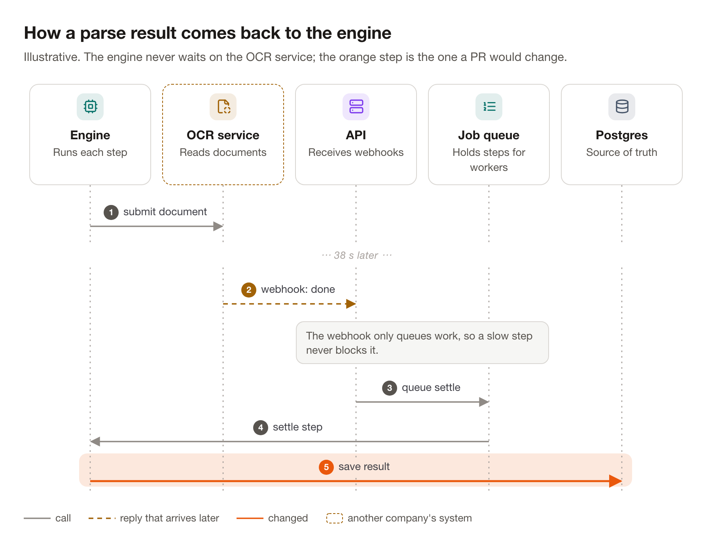
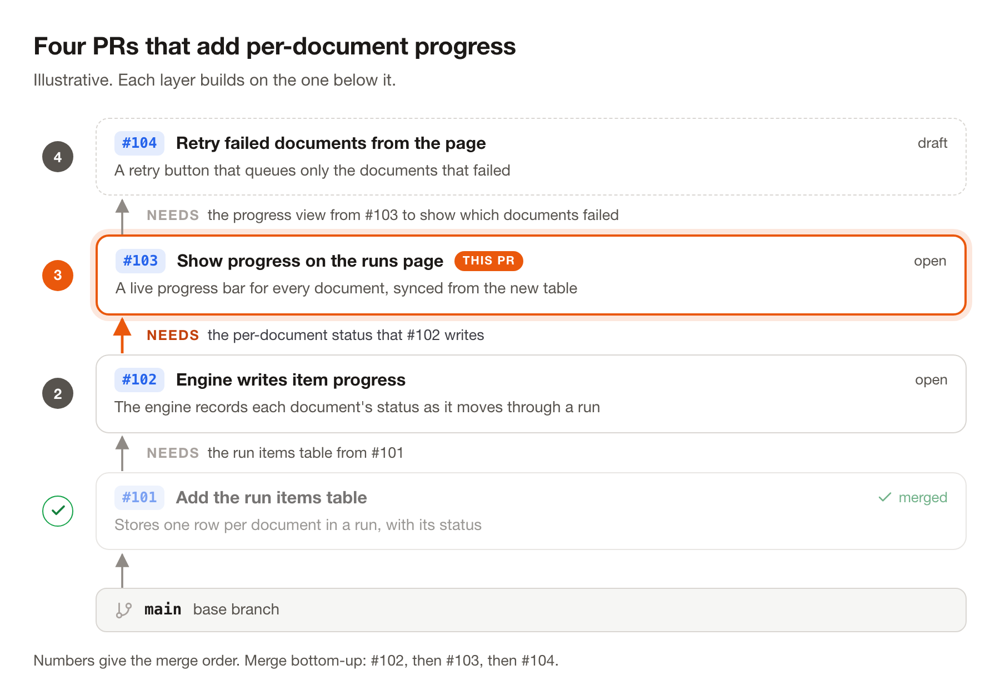
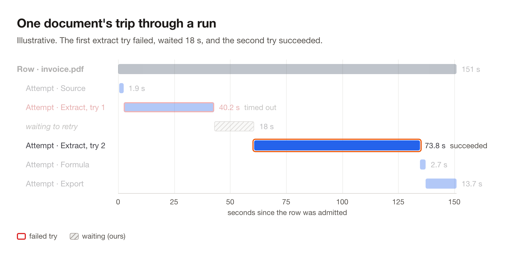

# doc-figures

An agent skill that draws clear diagrams for PR descriptions and design docs. The agent writes a short JSON
spec; the skill lays it out, checks it for overlaps and tiny text, and renders light and dark PNGs in about a
second.

```sh
npx skills add zhuasy/doc-figures
```

Works with Claude Code, Codex, Cursor and other agents that read skills. Add `-g` to install it for every
project. Then ask for a picture: "add a before/after diagram to this PR".

Needs Node 22+ and Google Chrome or Chromium (set `CHROME_PATH` if it lives somewhere unusual).

## What it draws

| Template | For |
| --- | --- |
| `flow` | The parts of a system and how requests move between them |
| `compare` | Before and after: what a change does differently |
| `stack` | Stacked PRs: what each adds, what it needs, merge order |
| `sequence` | Who calls whom, in order, including replies that arrive later |
| `card` | The fields of a record or table, and links between them |
| `timeline` | Where time went: waterfalls, retries, waits |
| `layers` | A layered architecture where each layer works both ways with the next |

<picture>
  <source media="(prefers-color-scheme: dark)" srcset="docs/flow-small.dark.png">
  
</picture>

<picture>
  <source media="(prefers-color-scheme: dark)" srcset="docs/compare-cache.dark.png">
  
</picture>

<picture>
  <source media="(prefers-color-scheme: dark)" srcset="docs/sequence.dark.png">
  
</picture>

<picture>
  <source media="(prefers-color-scheme: dark)" srcset="docs/stack.dark.png">
  
</picture>

<picture>
  <source media="(prefers-color-scheme: dark)" srcset="docs/timeline-trip.dark.png">
  
</picture>

## Render by hand

```sh
node skills/doc-figures/render/render.mjs skills/doc-figures/examples/*.json --out out
```

The specs behind every image above are in `skills/doc-figures/examples/`.

## License

MIT. The bundled elkjs (EPL-2.0) and Lucide icons (ISC) keep their own licenses: see
`skills/doc-figures/render/NOTICE.md`.
