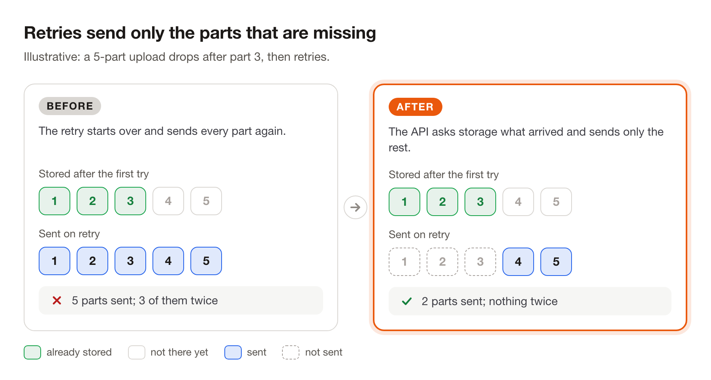
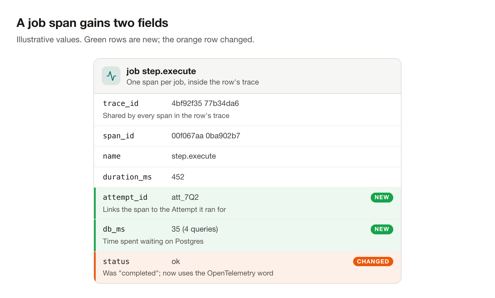
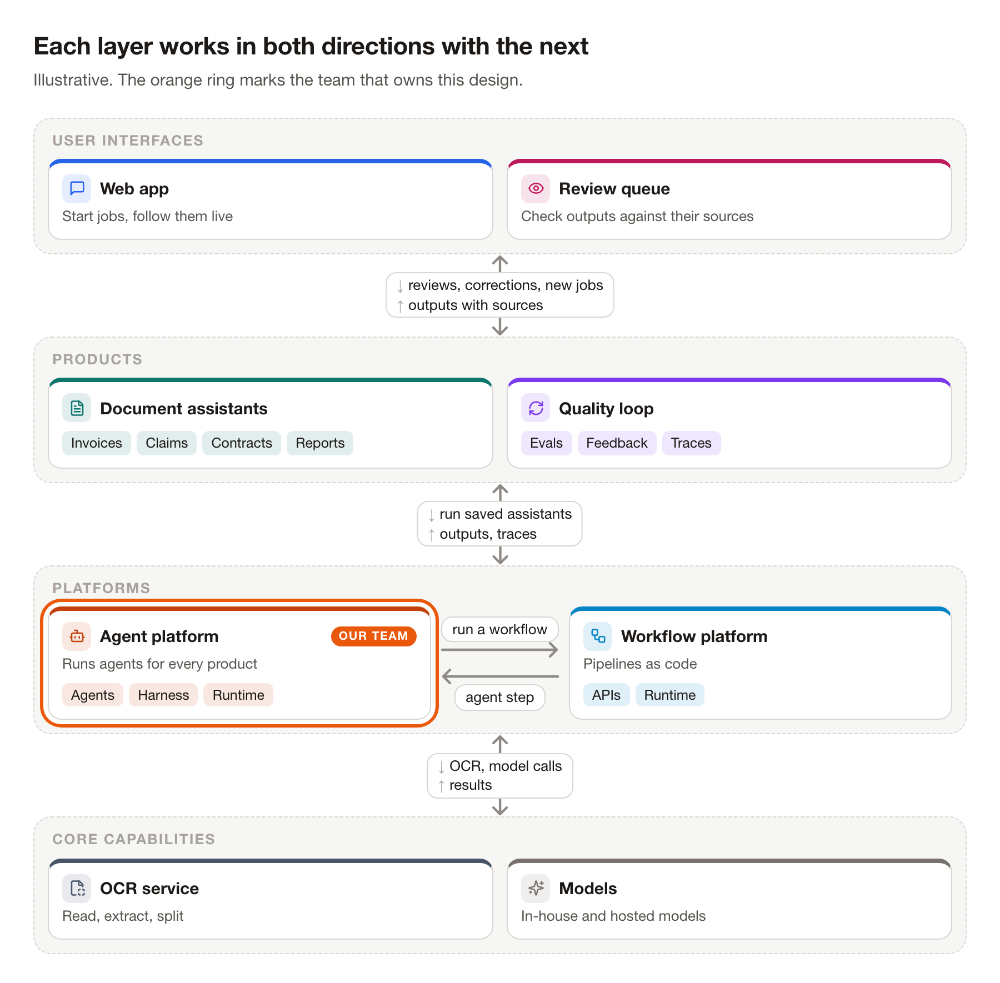

<h1 align="center">doc-figures</h1>

<p align="center">
  <b>Diagrams for PRs and design docs, from a few lines of JSON.</b><br>
  Your agent writes the spec. The skill lays it out, checks it, and renders light and dark PNGs in about a second.
</p>

<p align="center">
  <code>npx skills add zhuasy/doc-figures</code>
</p>

Ask your agent for a picture: *"add a diagram of the retry fix to this PR"*. It writes a spec like this:

```json
{
  "template": "flow",
  "title": "Retries resume where the upload stopped",
  "subtitle": "Illustrative. The API now asks storage which parts already arrived.",
  "nodes": [
    {"id": "browser", "label": "Browser", "icon": "monitor", "color": "blue",
     "does": "Splits the file into 5 parts"},
    {"id": "api", "label": "Upload API", "icon": "server", "color": "violet",
     "does": "Asks storage which parts it already has", "changed": true},
    {"id": "gcs", "label": "Cloud storage", "icon": "cloud", "color": "sky",
     "does": "Keeps parts 1–3 from the first try", "external": true}
  ],
  "edges": [
    {"from": "browser", "to": "api", "label": "retry the upload"},
    {"from": "api", "to": "gcs", "label": "list stored parts", "changed": true},
    {"from": "gcs", "to": "api", "label": "parts 1–3", "later": true}
  ]
}
```

and gets this:

<picture>
  <source media="(prefers-color-scheme: dark)" srcset="docs/flow-small.dark.png">
  
</picture>

- **No coordinates.** The spec names the parts and the links. The skill places boxes and routes arrows.
- **Checked on every render.** It warns about overlapping boxes, clipped labels and text too small to read.
- **Light and dark.** Both PNGs come out together, and GitHub shows the one that matches the reader's theme.
- **Sharp.** 1800 px wide for a 900 px column, so text stays crisp on retina screens.

## Seven templates

### `compare` · before and after

<picture>
  <source media="(prefers-color-scheme: dark)" srcset="docs/compare-upload-retry.dark.png">
  
</picture>

### `sequence` · who calls whom, including replies that arrive later

<picture>
  <source media="(prefers-color-scheme: dark)" srcset="docs/sequence.dark.png">
  
</picture>

### `stack` · stacked PRs, what each one needs, merge order

<picture>
  <source media="(prefers-color-scheme: dark)" srcset="docs/stack.dark.png">
  
</picture>

### `card` · the fields of a record, and what changed

<picture>
  <source media="(prefers-color-scheme: dark)" srcset="docs/card-span.dark.png">
  
</picture>

### `timeline` · where the time went

<picture>
  <source media="(prefers-color-scheme: dark)" srcset="docs/timeline-trip.dark.png">
  
</picture>

### `layers` · a layered architecture, both directions

<picture>
  <source media="(prefers-color-scheme: dark)" srcset="docs/layers.dark.png">
  
</picture>

`flow`, at the top, draws the parts of a system and how requests move between them.

## Install

```sh
npx skills add zhuasy/doc-figures      # add -g for every project
```

Works with Claude Code, Codex, Cursor and other agents that read skills. Needs Node 22+ and Google Chrome or
Chromium (set `CHROME_PATH` if it lives somewhere unusual).

To render by hand:

```sh
node skills/doc-figures/render/render.mjs skills/doc-figures/examples/*.json --out out
```

The specs behind every image on this page are in [`skills/doc-figures/examples/`](skills/doc-figures/examples).

## License

MIT. The bundled elkjs (EPL-2.0) and Lucide icons (ISC) keep their own licenses: see
[`NOTICE.md`](skills/doc-figures/render/NOTICE.md).
